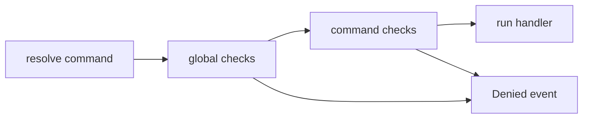

# Checks and cooldowns

[Docs](README.md) / Checks · [Precondition](../packages/core/src/commands/checks/Precondition.ts)

Add restrictions to a command's `static options`:

```ts
static override options: Command.Options = {
	runIn: "GUILD_ANY",
	requiredUserPermissions: ["ManageMessages"],
	requiredClientPermissions: ["SendMessages"],
	cooldownDelay: 5000,
	cooldownLimit: 1,
};
```

This allows a guild invocation from someone with Manage Messages, requires the
bot's Send Messages permission, and allows one use per user every five seconds.
Use a [denial listener](events.md#reply-to-failures) to tell the user when a check
fails.

## What runs first?



Global preconditions run in ascending `position`, then the command's checks run.
An error result stops that invocation and emits its Denied event. Passing checks
leads to the handler; a thrown handler error emits the Error event.

| Option                      | Omitted behavior                                                                                   |
| --------------------------- | -------------------------------------------------------------------------------------------------- |
| `runIn`                     | No channel restriction; accepts named channel types, numeric types, arrays or per-handler settings |
| `nsfw`                      | No NSFW requirement                                                                                |
| `requiredUserPermissions`   | No additional user permission bits required                                                        |
| `requiredClientPermissions` | No additional bot permission bits required                                                         |
| `preconditions`             | No extra named checks                                                                              |

`runIn: []` is invalid. Prefer `runIn` over legacy thread-only check names.
Runtime permission checks do not configure Discord's command visibility;
set the registration builder's default member permissions separately if needed.

Interactions use Discord's app/member permission snapshot. Message checks combine
guild roles and channel overwrites, fetching missing native data as needed.
Owner/Administrator overrides and member timeouts are applied. A fetch failure
can reject the check. Native member and channel data do not have SDK
`permissionsFor()` methods.

For direct use, `await message.permissionsFor(userId)` returns a Virello
`Permissions` mask. `Discord.canSendMessages(channel, client)` and related
helpers are async; thread membership/occupancy checks depend on available state.

## Write a check

**`preconditions/available.ts`** rejects slash commands during maintenance:

```ts
import { Precondition } from "virello/commands";

export default class Available extends Precondition {
	override chatInputRun(): Precondition.Result {
		return this.container.client.maintenance
			? this.error({
					identifier: "Maintenance",
					message: "Coordination is recovering. Try again shortly.",
				})
			: this.ok();
	}
}

declare module "virello" {
	interface Preconditions {
		available: never;
	}
}
```

Load `modules.preconditions: "preconditions/**/*.ts"`, then put
`preconditions: ["available"]` on the relevant commands.
`never` declares that this check needs no extra context.

For a global check, give it `static options = { position: 10 }` instead of
attaching its name to each command. Implement every flow that will use it:
`messageRun`, `chatInputRun` and/or `contextMenuRun`. A missing flow is not a
universal pass. `AllFlowsPrecondition` requires all three methods.

## Cooldowns

| Setting                                   | Default                               | Notes                                     |
| ----------------------------------------- | ------------------------------------- | ----------------------------------------- |
| `cooldownDelay`                           | `defaultCooldown.delay ?? 0`          | Milliseconds; zero disables               |
| `cooldownLimit`                           | `defaultCooldown.limit ?? 1`          | Uses per fixed window; zero disables      |
| `cooldownScope`                           | `BucketScope.User`                    | Also `Channel`, `Guild`, `Global`         |
| `cooldownFilteredUsers`                   | `defaultCooldown.filteredUsers ?? []` | Exempt user IDs                           |
| Client `defaultCooldown.filteredCommands` | `[]`                                  | Commands exempt from the default cooldown |

Buckets belong to a command instance **in one process**. `Global` means all
callers of that command in that process, not a distributed limit across shards.
A use is consumed during the check; a later handler failure does not refund it.
Cooldown errors expose `context.remaining` in milliseconds.

For your own non-command limits, use
[`RateLimitManager`](utilities.md#time-and-small-rate-limits).
Discord REST limits and IDENTIFY permits are [different controls](caching-and-limits.md#three-different-limits).
