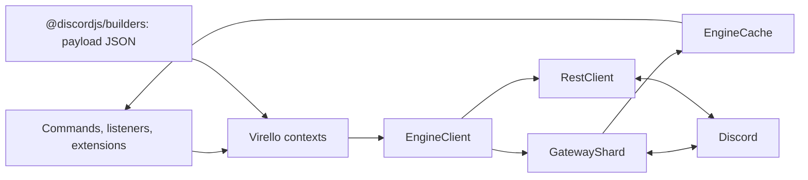

# The native engine

[Docs](README.md) / Engine · [Exports](../src/public/engine.ts)



Virello owns its gateway, REST transport, cache and sharding. The framework uses
`client.engine`; `client.rest` and `client.cache` reference that same engine's
resources. Builders only construct payloads. There is no discord.js client or
fallback transport.

## Use the lower-level API

Most bots should start with [`VirelloClient`](getting-started.md). Use a standalone
engine when you want native dispatch handling without modules or command routing:

```ts
import { EngineClient } from "virello/engine";
import { GatewayIntentBits } from "discord-api-types/v10";

const token = Bun.env.DISCORD_TOKEN;
if (!token) throw new Error("Set DISCORD_TOKEN.");

const engine = new EngineClient({
	token,
	intents: GatewayIntentBits.Guilds,
	onError: ({ source, error, fatal }) => {
		console.error(source, fatal, error);
	},
});
const unsubscribe = engine.on("dispatch", (payload) => {
	console.log(payload.t);
});
await engine.connect();
// At shutdown:
unsubscribe();
engine.close();
```

Construction opens no connections. A standalone engine does not set
`container.client`, load commands or install extensions. Its `on()` returns an
unsubscribe function; framework `client.on()` follows EventEmitter conventions.

## Gateway recovery

| Situation                                     | Engine behavior                                                          |
| --------------------------------------------- | ------------------------------------------------------------------------ |
| Socket loss / reconnect request               | Reconnect; try RESUME with session URL and last accepted sequence        |
| Invalid/non-resumable session                 | Discard session cache, wait as required, then fresh IDENTIFY             |
| Missing heartbeat ACK                         | Treat the socket as stalled and reconnect                                |
| Malformed/oversized frame                     | Reject it and recover                                                    |
| Stale socket callback                         | Ignore it after a newer connection takes ownership                       |
| Fatal auth/config close or exhausted recovery | Close engine; framework destroys its client                              |
| Changed managed shard tuple                   | Abort old connection/permit, clear session cache, connect with new tuple |

Defaults: 15 seconds per handshake stage, 8 MiB inbound frames and 10 consecutive
recovery attempts. A healthy connection resets the recovery count. One engine
owns one gateway shard. Discord recommending multiple shards requires a tuple;
use [managed sharding](sharding.md) to coordinate processes and login permits.

`ClientReady` means a fresh READY; RESUME emits `Resumed`. Application command
registration and extension login hooks are not repeated on every socket resume.

## Ordering and limits

1. Decode a dispatch.
2. Apply its cache changes synchronously.
3. Invoke specialised handlers, then the native dispatch handler.

Async **engine** handlers can overlap. Their promises are tracked; `idle()`
waits for them. The default cap is 1,024 unfinished handlers; overflow closes
the engine. Ordinary handler failures reach `onError`.

Framework listeners use their own EventEmitter/module error handling. They are
not counted by `engine.pendingHandlers`, and `engine.idle()` does not wait for
all command work. [REST/cache limits](caching-and-limits.md) are separate.

## Current boundaries

- JSON gateway transport; no compression, voice connection, or full Discord
  payload validation.
- Focused entity caches; no complete reaction-count, presence, or thread-member
  cache reconciliation.
- Explicit REST helpers for common reads; `rest.request<T>()` covers other API
  routes. Multipart files are supported.
- No automatic interaction deferral or reserved response-deadline queue.
- No persistent session-start ledger or shared REST scheduler across processes.
- Local protocol fixtures exercise recovery; this migration has not been
  validated with a live bot or long-running production load.

Try the local fake Discord server with `bun examples/engine/offline.ts`.
See the [framework examples](../examples/README.md) for the normal bot runtime.
