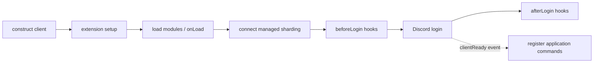

# Modules and lifecycle

[Docs](README.md) / Modules · [Registry](../packages/core/src/core/modules/ModuleRegistry.ts) ·
[Loader](../packages/core/src/core/loading/ModuleLoader.ts)

## Choose what loads

Put this in your client options:

```ts
modules: {
	commands: ["commands/**/*.ts", "!commands/**/drafts/**"],
	listeners: "listeners/**/*.ts",
	interactions: "interactions/**/*.ts",
	services: "services/**/*.ts",
}
```

| Store key       | Export a class extending  | Extension required |
| --------------- | ------------------------- | ------------------ |
| `commands`      | `Command` or `Subcommand` | Core               |
| `listeners`     | `Listener`                | Core               |
| `interactions`  | `InteractionHandler`      | Core               |
| `arguments`     | `Argument`                | Core               |
| `preconditions` | `Precondition`            | Core               |
| `patterns`      | `PatternCommand`          | `patternCommands`  |
| `tasks`         | `Task`                    | `scheduledtasks`   |
| `services`      | `Service`                 | `services`         |

- Paths are relative to `root`; use `/` on every platform.
- Files must end in `.ts`. Declaration files and file names beginning with
  `.`, `_` or `-` are skipped.
- Default and named class exports work. Multiple exports need distinct
  `static options.name` values if they would otherwise share a file name.
- Export a compatible class, not an instance. Static `options` become its
  constructor options.
- Nothing scans a `commands/` folder unless you configure it. A missing
  directory can produce an empty store without failing startup.

Prefer one module per file. Put helpers outside the globs, or prefix their
file names with `_`.

## Register a class directly

For an existing client and a command class imported from your own code:

```ts
await client.modules.addModule({
	store: "commands",
	name: "ping",
	module: PingCommand,
});
await client.load();

const commands = client.modules.require("commands");
console.log(commands.get("ping"));
```

Direct registrations precede discovered files. Startup preserves store order,
sorted file order and sorted export names; canonical file paths are deduplicated.
The first accepted name wins. A duplicate warns instead of replacing the module.
After startup, `addModule()` can activate a class, but it does not re-run Discord
command registration.

## Startup and shutdown



In words: construction runs synchronous extension setup; `login()` loads modules,
connects managed sharding when enabled, runs `beforeLogin`, logs in to Discord,
then runs `afterLogin`. The ready listener performs command registration
separately; login completion is not a registration-success guarantee.

| Hook                     | Use it for                                                                             |
| ------------------------ | -------------------------------------------------------------------------------------- |
| Module `onLoad()`        | Initialize a module before it enters its store                                         |
| Module `onUnload()`      | Release its timers, subscriptions and connections; also called after failed activation |
| `client.addDisposer(fn)` | Client/extension resources; callbacks are awaited in reverse registration order        |

`destroy()` stops managed sharding, waits for active hooks, runs disposers,
unloads modules, disconnects Discord and closes its owned logger. It attempts
cleanup even when another resource fails, then rejects with an `AggregateError`
if needed. A supplied logger remains your responsibility.

## When loading fails

| Failure                                          | Result                                                |
| ------------------------------------------------ | ----------------------------------------------------- |
| Bad glob or unknown/disabled store in config     | Construction throws                                   |
| Import, constructor or ordinary `onLoad` failure | Logs and skips that candidate; other modules can load |
| Activation and rollback both fail                | Startup fails and client cleanup runs                 |
| Store finalization fails                         | Startup fails                                         |
| Optional extension hook fails                    | Extension disabled and tracked resources rolled back  |
| Critical extension hook fails                    | Client startup fails                                  |

Turn on `traceModules: true` **and** debug logging when a file seems missing.
Check `client.modules.require("commands").keys()` after `load()`; a resolved
startup promise alone does not prove every candidate loaded.

> [!TIP]
> Restart after editing files, globs or translations. Calling `load()` again
> reuses the startup result; it does not reload the source.

Use `await module.unload()` for explicit cleanup. Setting `enabled = false`
alone is not an unload operation. For custom stores, extend `ModuleStore`,
register it during extension setup and augment `ModuleStores` on `"virello"`.
[Store contracts →](../packages/core/src/core/modules/ModuleStore.ts)
