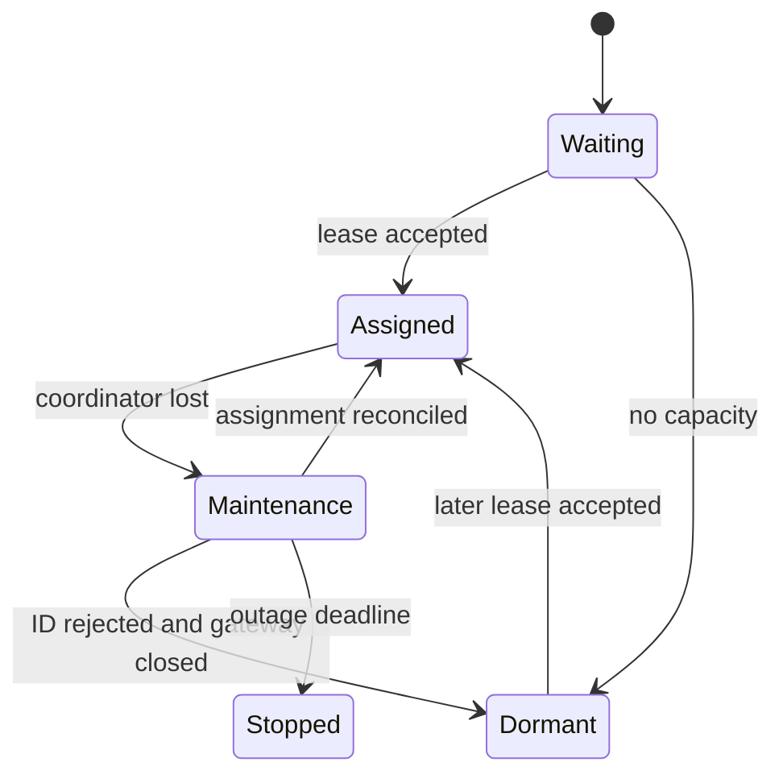

# Maintenance and recovery

[Docs](README.md) / [Sharding](sharding.md) / Recovery

For an operation that needs coordination, choose an outage reply in your handler:

```ts
if (this.container.client.maintenance) {
	await interaction.reply("Coordination is recovering. Try again shortly.");
	return;
}
```

Virello maintains the flag. Your application decides which commands can continue.
Local commands may still work while the existing Discord connection stays open.

## Follow the state

| Situation                        | Discord connection                      | `maintenance`                                     | What happens next                 |
| -------------------------------- | --------------------------------------- | ------------------------------------------------- | --------------------------------- |
| Managed child starting           | Closed until assigned                   | `true`                                            | Wait for an accepted lease        |
| Reconciled assignment            | Open/login permitted                    | `false`                                           | Normal operation                  |
| Coordinator connection lost      | Existing session kept open              | `true`                                            | Host reconnects; child reconciles |
| Same ID and total accepted       | Existing session preserved              | Clears after reconciliation                       | Resume coordination               |
| Total changes                    | Old gateway closed, cache/session reset | Clears after assignment is applied and registered | Reconnect using new total         |
| ID taken/invalid, or no capacity | Closed                                  | `true`                                            | Child becomes dormant             |
| Assigned outage lifetime expires | Closed                                  | Process terminates                                | Host restart policy applies       |

Unmanaged clients default to `maintenance = false`. A socket welcome alone does
not clear maintenance: authentication, lease acceptance, local assignment
application and coordinator registration must finish.



In words: assigned children keep Discord during a bounded outage. Rejected or
unassigned children close Discord and wait dormant until a slot becomes available.

## Recovery knobs

These are `ShardManager` options, in milliseconds unless stated otherwise:

| Option                                    | Default          | Effect                                            |
| ----------------------------------------- | ---------------- | ------------------------------------------------- |
| `reconnect`                               | Enabled          | Coordinator retries without an attempt limit      |
| `reconnect.initialDelayMs` / `maxDelayMs` | `500` / `30000`  | Capped reconnect backoff                          |
| `restart.maxRestarts`                     | `5`              | Consecutive child crash restarts                  |
| `restart.initialDelayMs` / `maxDelayMs`   | `1000` / `30000` | Exponential restart backoff with jitter           |
| `restart.stableAfterMs`                   | `60000`          | Uninterrupted uptime needed to reset crash count  |
| `startupTimeoutMs`                        | `30000`          | Each handshake/boot attempt                       |
| `shutdownTimeoutMs`                       | `5000`           | Each graceful shutdown stage                      |
| `identifyTimeoutMs`                       | `120000`         | Permit queue and identification; maximum `300000` |
| `assignmentPollIntervalMs`                | `30000`          | Dormant polling; accepts `50..300000`             |
| `maxDisconnectedLifetimeMs`               | `900000`         | Assigned outage lifetime; accepts `1..2147483647` |

`restart: false` disables crash restarts. `reconnect: false` opts out of
coordinator recovery and stops children on loss. A host can start before the
coordinator and retry; `manager.close()` cancels the wait.

A silent partition is detected by the 15-second heartbeat deadline. Failed
connections or welcomes do not reset an assigned child's outage timer; successful
reconciliation does. Dormant children are exempt once the old gateway is closed
and may stay alive indefinitely. Their first `login()` or transport `connect()`
can therefore remain pending.

## Leases are process ownership

- A lease belongs to an authenticated host, supervisor instance and child
  generation. Initial `workers[].shards` are placement preferences.
- Connection loss **does not release ownership** during a coordinator's lifetime.
  The owner must confirm child exit or graceful release.
- Valid returning IDs can be retained even if host capacity was reduced.
  A taken/invalid ID is forgotten: `client.sharding.id` becomes `null`.
- Different authenticated supervisor instances can wait dormant. Duplicate
  sockets for the same instance are refused.
- `manager.processes` reports local `slot`, nullable `shard`, `pid`,
  `restarts` and `state`. A local slot is not a Discord shard ID.

## Restart tradeoffs

> [!IMPORTANT]
> Coordination lives in memory. A coordinator restart immediately rebuilds the
> pool; there is no global reconciliation grace period or durable ownership lock.
> A partitioned old Discord session can overlap a replacement until it reconnects
> or reaches its outage cutoff. Exactly-once processing is not guaranteed.

Run **one coordinator per bot** and supervise each host's whole process tree.
A responsive child exits on parent IPC loss. A new supervisor cannot prove its
predecessor's children died just by presenting the same host credentials; those
leases remain reserved until coordinator restart. A wedged process needs external
process supervision.

Gateway reassignment keeps the VirelloClient, modules and application listeners
alive. It resets gateway resume data and guild/channel/user caches when the
assignment changes. Extension login hooks do not repeat; Discord ready events
can repeat.

## Requests and login permits during recovery

Ordinary calls fail fast with `DISCONNECTED`. Opt into
[`waitForCoordinator`](shard-messaging.md#deadlines-and-bounds) for bounded waiting.
Dispatched calls fail on disconnect and are never replayed. A reconciled caller
can still get `UNAVAILABLE` from a destination, or `RESHARDING` during a drain.

Every fresh IDENTIFY needs a coordinator permit. With `botToken`, startup waits
5.5 seconds before fetching fresh Discord metadata; this is a login cooldown,
not an ownership grace period. Permits are charged before delivery and never
refunded. Manual `sessionStartLimit` snapshots need refreshing on restart/expiry;
elapsed time alone never replenishes them.

No `statePath`, `stateDirectory`, `releaseWorker` or disk cleanup is involved.
Old state files remain unused. [Migration notes](../BREAKING_CHANGES.md) ·
[Recovery implementation](../src/sharding/client/gateway.ts)
