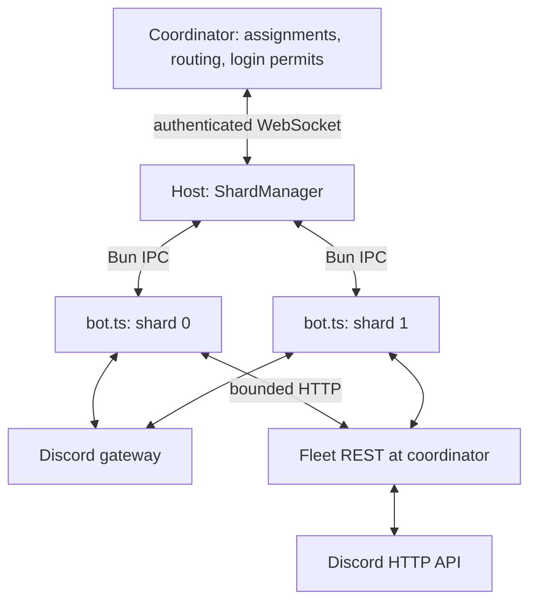

# Run multiple shard processes

[Docs](README.md) / Sharding · [Options](../packages/sharding/src/types.ts)

**[Run the coordinator + host example →](../examples/README.md)**



The coordinator assigns shards and routes calls. A host supervises local Bun
processes. Each child runs your bot and connects to Discord with its own shard
ID. Children talk through their host, not directly to each other.

| Role            | Public class       | Owns                                                                        |
| --------------- | ------------------ | --------------------------------------------------------------------------- |
| Coordinator     | `ShardCoordinator` | Authenticated hosts, in-memory leases, IDENTIFY allowance, optional scaling |
| Host/supervisor | `ShardManager`     | Child processes, restart backoff, coordinator reconnection                  |
| Bot child       | `VirelloClient`    | Modules, Discord connection/cache, `client.sharding` messaging              |

`workers` in coordinator options means configured hosts, not JS Worker threads.
A small bot can use [one standalone client](getting-started.md); a managed setup
can also run just one shard.

## Coordinator setup

**`coordinator.ts`** for a two-shard local deployment:

```ts
import { ShardCoordinator } from "virello/sharding";

const botToken = Bun.env.DISCORD_TOKEN;
const token = Bun.env.SHARD_HOST_TOKEN;
if (!botToken || !token) throw new Error("Set both bot and host tokens.");

const coordinator = new ShardCoordinator({
	applicationId: Bun.env.DISCORD_APPLICATION_ID!,
	shardCount: 2,
	workers: [{ id: "local", token, shards: [0, 1] }],
	botToken,
});
const stop = () => {
	void coordinator.close().catch((error: unknown) => {
		console.error(error);
		process.exitCode = 1;
	});
};
process.once("SIGINT", stop);
process.once("SIGTERM", stop);
await coordinator.start();
// Production admission remains blocked until an operator reviews prior process
// trees and external effects, then calls confirmFleetStopped. See the runbook.
```

Generate a separate host secret of 32–512 printable ASCII characters. The
coordinator defaults to `127.0.0.1:8080`, with the `/sharding` WebSocket route.
`workers[].shards` must initially cover every ID in `0..shardCount-1` exactly once.
Every production start requires the explicit
[recovery confirmation](sharding-recovery.md#restart-runbook). Contact loss keeps
existing Gateway ownership sticky; state loss never automatically adopts workers.
The [example](../examples/README.md) provides a local stdin confirmation flow.

## Host setup

**`host.ts`**, beside your existing **`index.ts`** bot entrypoint:

```ts
import { ShardManager } from "virello/sharding";

const token = Bun.env.SHARD_HOST_TOKEN;
if (!token) throw new Error("Set SHARD_HOST_TOKEN.");

const manager = new ShardManager({
	id: "local",
	token,
	url: "ws://127.0.0.1:8080/sharding",
	script: new URL("./index.ts", import.meta.url),
	cwd: import.meta.dir,
});
const stop = () => {
	void manager.close().catch((error: unknown) => {
		console.error(error);
		process.exitCode = 1;
	});
};
process.once("SIGINT", stop);
process.once("SIGTERM", stop);
await manager.start();
```

Start `bun coordinator.ts` and `bun host.ts` in separate terminals. The host
inherits the environment, including `DISCORD_TOKEN`, and starts the bot children.
Use [one command registration writer](commands.md#registration-behavior).
Keep global command writes, schema migrations and singleton scheduled jobs in an
explicit deployment role or a designated owned shard. Importing the worker module
on every process is not authority to perform global startup work.

Managed REST uses the [fleet HTTP dispatcher](sharding-rest.md). It is independent
of typed control IPC/WS; do not bypass it with per-worker bot-token fetch calls.

> [!IMPORTANT]
> Start the host, not the bot entrypoint separately. Do not set `VIRELLO_SHARD`
> yourself: it is reserved for authenticated manager-owned IPC children.
> Upgrade coordinator, hosts and bot code together.

## Move hosts to other machines

- [ ] Give each host a unique `id` and secret in `workers`.
- [ ] Put the same bot code and Bun version on each host.
- [ ] Set coordinator `hostname` and Bun `tls` options; non-loopback listeners
      require TLS.
- [ ] Use a trusted `wss://host:port/sharding` URL. Remote plain `ws://` is
      rejected; URL credentials, query strings and fragments are unsupported.
- [ ] Supervise each host's entire child process tree.

In fixed mode, host capacity defaults to its initial shard count; `maxShards`
can set a larger capacity. `processCount` on the manager sets a minimum local
pool, including dormant standbys, within capacity.

| Next task                                | Guide                                                              |
| ---------------------------------------- | ------------------------------------------------------------------ |
| Call another shard                       | [Typed messaging](shard-messaging.md)                              |
| Handle coordinator outages               | [Maintenance and recovery](sharding-recovery.md)                   |
| Understand login permits                 | [Caching and limits](caching-and-limits.md#three-different-limits) |
| Change counts on existing hosts          | [Automatic scaling](sharding-scaling.md)                           |
| Read fresh process statistics            | [Shard statistics](sharding-stats.md)                              |
| Observe lifecycle or restart local slots | [Operational APIs](sharding-operations.md)                         |
