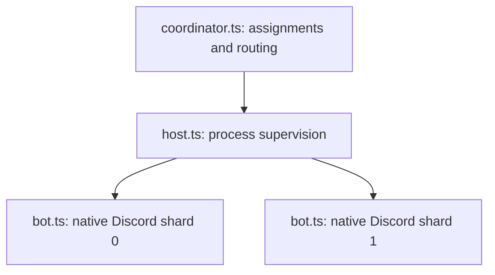

# Run the example bot

[Developer docs](../docs/README.md) · [Build your own bot](../docs/getting-started.md)

From the repository root, using Bun canary:

```sh
bun install --frozen-lockfile
bun examples/offline.ts
```

That starts a temporary coordinator, host and two bot children, checks module
loading and shard messages, then cleans up. It needs no Discord token.

## Ticket flow

The [ticket example](tickets/README.md) shows a Components V2 panel, labelled
modal uploads, a deferred submission, private channel creation and a transcript
attachment using only Virello. It is opt-in and uses the existing shard setup.

## Three roles, one bot



Every child loads the same commands, with its own engine and cache. The default
setup uses two shards so you can try cross-process calls; `SHARD_COUNT=1` works.

## Connect it to Discord

1. Copy `examples/.env.example` to `examples/.env`:

   ```powershell
   Copy-Item examples/.env.example examples/.env
   ```

2. Set `DISCORD_TOKEN`. Generate a **separate** host secret:

   ```sh
   bun -e "console.log(crypto.randomUUID() + crypto.randomUUID())"
   ```

   Put that value in `SHARD_HOST_TOKEN` for the coordinator and host.

3. Set `DEV_GUILD_ID` to a test server, or leave it blank for global commands.
   Install the app with `bot` and `applications.commands` scopes.
   These slash-command examples need only the Guilds intent.

4. Start the coordinator:

   ```sh
   bun --env-file=examples/.env examples/coordinator.ts
   ```

5. Once it accepts host connections, start the host in another terminal:

   ```sh
   bun --env-file=examples/.env examples/host.ts
   ```

The host launches `bot.ts`. Do not launch it separately or set
`VIRELLO_SHARD` manually. Wait for registration/readiness logs before trying
commands. Login permits can stagger startup.

| Command       | Does                                                          |
| ------------- | ------------------------------------------------------------- |
| `/ping`       | Reports the handling shard and last gateway heartbeat latency |
| `/stats`      | Broadcasts for counts, memory and uptime                      |
| `/shard id:1` | Requests one shard; IDs start at zero                         |

Replies are ephemeral. Requests time out after five seconds; failed shard values
stay unknown. Shard 0 writes command registrations; every shard loads and routes
the commands.

## Change the example

| File                                                 | Change                                                            |
| ---------------------------------------------------- | ----------------------------------------------------------------- |
| [client.ts](client.ts)                               | Intents, module paths, native cache reads, `exampleStats` handler |
| [commands/](commands)                                | Add a `Command` subclass                                          |
| [registration.ts](registration.ts)                   | Registration writer and scope                                     |
| [contracts.ts](contracts.ts)                         | Typed plain-JSON request/response contracts                       |
| [stats.ts](stats.ts)                                 | Discord reply formatting and responding-shard totals              |
| [config.ts](config.ts)                               | Validated environment settings                                    |
| [logging.ts](logging.ts), [shutdown.ts](shutdown.ts) | Process logging and awaited cleanup                               |
| [listeners/ready.ts](listeners/ready.ts)             | Application work after fresh READY                                |

Restart the host after changing code. Stop the host before the coordinator for
normal shutdown. See [maintenance and recovery](../docs/sharding-recovery.md)
for outages, dormant slots and retained sessions.

Changing `DEV_GUILD_ID` does not delete commands from their old scope.
To clear **all global commands and all commands in the configured dev guild**,
stop the host and deliberately run:

```sh
bun --env-file=examples/.env examples/unregisterCommands.ts
```

That script uses Virello's native REST client. The next normal startup registers
the example commands again.

## Environment reference

| Variable                           | Default / purpose                                                    |
| ---------------------------------- | -------------------------------------------------------------------- |
| `DISCORD_TOKEN`                    | Required for live runs; same bot on coordinator and hosts            |
| `DEV_GUILD_ID`                     | Blank: global commands                                               |
| `SHARD_COUNT`                      | `2`; initial total                                                   |
| `SHARD_HOST_ID`                    | `local`                                                              |
| `SHARD_HOST_TOKEN`                 | Required separate host secret, 32–512 printable ASCII characters     |
| `SHARD_COORDINATOR_URL`            | `ws://127.0.0.1:8080/sharding`                                       |
| `SHARD_COORDINATOR_HOST` / `PORT`  | `127.0.0.1` / `8080`; port `0` picks a free port                     |
| `SHARD_ASSIGNMENT_POLL_MS`         | `30000`; dormant slot polling                                        |
| `SHARD_MAX_DISCONNECTED_MS`        | `900000`; assigned outage cutoff                                     |
| `SHARD_WORKERS`                    | Optional JSON array of host IDs, secrets, shard lists and capacities |
| `SHARD_SCALING`                    | Blank: fixed mode; JSON opts into scaling                            |
| `SHARD_HOST_MAX_SHARDS`            | Capacity for the simple host configuration; required for scaling     |
| `SHARD_TLS_CERT` / `SHARD_TLS_KEY` | Coordinator PEM certificate/key paths                                |

For other machines, use distinct host secrets and trusted TLS:
[host setup](../docs/sharding.md#move-hosts-to-other-machines).
For automatic resharding, configure capacity first:
[scaling guide](../docs/sharding-scaling.md). It does not create machines.

## Inspect logs or the low-level engine

```powershell
$env:VIRELLO_LOG_LEVEL = 'debug'
$env:VIRELLO_LOG_FORMAT = 'json'
```

Apply those in the relevant terminal before starting its process.
[Logging reference](../docs/console-logging.md)

```sh
bun examples/engine/offline.ts
```

The low-level example uses a local fake Discord server to connect, reply and
resume. `examples/engine/live.ts` is explicitly opt-in with `--live`; without
it, it only prints setup instructions. The native migration was not validated
against a live bot.
